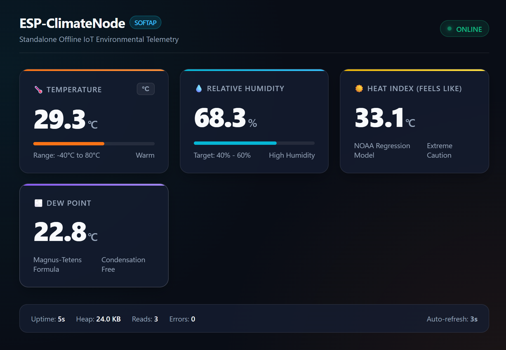
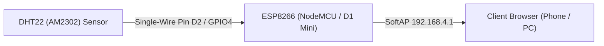
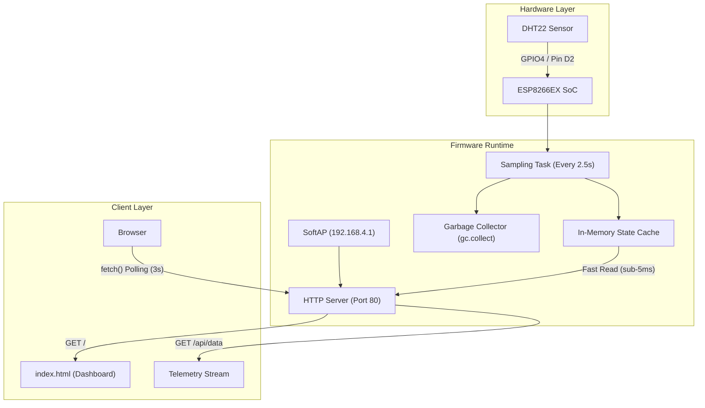

<div align="center">

# ESP-ClimateNode

**Standalone offline environmental telemetry node powered by ESP8266 and DHT22 running MicroPython.**

[](LICENSE)
[](https://micropython.org/)
[](https://www.espressif.com/en/products/socs/esp8266)
[]()

[Report a Bug](https://github.com/sumitrawat2417/esp-climate-node/issues) · [Request a Feature](https://github.com/sumitrawat2417/esp-climate-node/issues)



</div>

---

## Overview

**ESP-ClimateNode** is an edge-computing environmental telemetry station built with an ESP8266 microcontroller and a DHT22 digital climate sensor. Written in MicroPython, the node operates completely offline without requiring external Wi-Fi routers, internet connectivity, or third-party cloud platforms.

**The problem:** Most introductory IoT climate monitors depend on pre-configured home routers, internet gateways, and remote cloud services. When deployed in remote sheds, server closets, field environments, or captive-network facilities, these systems fail due to network isolation, authentication barriers, or cloud outages.

**The approach:** ESP-ClimateNode moves all computing, storage, and presentation to the microcontroller itself. On boot, the board broadcasts its own standalone Wi-Fi Soft Access Point (SoftAP) and runs an internal HTTP server. Any smartphone, tablet, or laptop can connect to the local network and access a self-hosted, responsive browser dashboard that streams live sensor data without page reloads.

## Features

- **Offline-First SoftAP:** Broadcasts a standalone 802.11 b/g/n Wi-Fi network (`ESP-Climate-Node`) with onboard DHCP assigning addresses on the `192.168.4.0/24` subnet.
- **Decoupled Sensor Sampling:** An internal cooperative timer reads the DHT22 every 2.5 seconds into an in-memory cache, preventing single-wire bus timeouts during concurrent browser requests.
- **Real-Time Web Dashboard:** Single-page application served directly from flash memory with zero external CDN dependencies, updating via asynchronous JavaScript polling every 3 seconds.
- **Derived Physiological Metrics:** Computes the official NOAA Rothfusz Heat Index ("Feels Like") and Magnus-Tetens Dew Point directly on the microcontroller.
- **Interactive Unit Toggle:** Switch seamlessly between Celsius (°C) and Fahrenheit (°F) on the web dashboard without rebooting or altering firmware state.
- **RESTful JSON API:** Exposes `/api/data` and `/api/status` endpoints with CORS headers enabled for integration with external tools and collectors.
- **Captive Portal Redirection:** Intercepts common OS network probes (`/generate_204`, `/hotspot-detect.html`, `/ncsi.txt`) to open the dashboard automatically upon connecting.
- **Flash Wear Protection:** Custom deployment tooling (`scripts/sync.py`) hashes on-chip files via SHA-256 and only writes modified files, preventing flash memory degradation.
- **Memory Optimized:** Streams HTML responses in 512-byte chunks and invokes garbage collection (`gc.collect()`) after client disconnections to run stably within the ESP8266's ~40 KB free heap.

## Tech Stack

| Layer | Technology | Details |
| --- | --- | --- |
| Microcontroller | Espressif ESP8266EX | 32-bit Tensilica L106 @ 80 MHz, integrated 2.4 GHz 802.11 b/g/n Wi-Fi |
| Sensor | Aosong DHT22 / AM2302 | Capacitive humidity element, NTC thermistor, single-wire digital bus |
| Firmware | MicroPython (v1.20+) | Bare-metal Python runtime with native `dht`, `usocket`, and `network` modules |
| Web Server | MicroPython Socket Server | Non-blocking BSD socket listener on port 80 |
| Frontend | HTML5 / CSS3 / Vanilla JS | Glassmorphic dark UI, CSS Grid, ES6 `fetch()` polling, no external CDNs |
| Host Tooling | Python 3, `esptool`, `mpremote` | Flashing, serial control, and SHA-256 differential synchronization |

## Hardware Overview

The physical node consists of an ESP8266 development board connected to a DHT22 digital temperature and humidity sensor via a single-wire digital bus with a pull-up resistor.



## Bill of Materials

| Qty | Component | Model / Specification | Purpose | Notes |
| ---: | --- | --- | --- | --- |
| 1 | Microcontroller Board | ESP8266 NodeMCU (v2/v3) or Wemos D1 Mini | Main CPU, Wi-Fi radio, and web server host | 3.3 V logic level |
| 1 | Temperature & Humidity Sensor | DHT22 / AM2302 | Ambient temperature and humidity sensing | Accuracy: ±0.5°C, ±2% RH |
| 1 | Resistor | 10 kΩ, 0.25 W | Pull-up resistor for single-wire bus | Not required if using a 3-pin breakout module |
| 1 | Solderless Breadboard | 400-point breadboard | Prototyping platform | — |
| 4 | Jumper Wires | Dupont wires (Male-to-Male or Male-to-Female) | Power and signal interconnects | Keep under 20 cm for signal integrity |
| 1 | Power Cable | Micro-USB to USB-A data cable | Power delivery and serial communication | Must support data lines |

## Wiring and Pinout

Pin numbering used below: **GPIO numbers** (internal MicroPython identifier) and **Board Labels** (silkscreen printed on NodeMCU / Wemos D1 Mini).

| Component | Component Pin | NodeMCU Pin | Wemos D1 Mini Pin | MicroPython Pin | Notes |
| --- | --- | --- | --- | --- | --- |
| DHT22 | Pin 1 (VCC) | 3V3 | 3V3 | 3.3 V Rail | Power rail (3.3 V DC) |
| DHT22 | Pin 2 (DATA) | D2 | D2 | GPIO4 | Single-wire bidirectional serial bus |
| DHT22 | Pin 3 (NC) | — | — | — | Not connected |
| DHT22 | Pin 4 (GND) | GND | G | GND | Common system ground |

> **Note on Pull-Up Resistor:** For bare 4-pin DHT22 sensors, wire a **10 kΩ resistor** between **Pin 1 (VCC)** and **Pin 2 (DATA)**. If using a 3-pin breakout board with pins labeled `+`, `-`, and `out`, the pull-up resistor and decoupling capacitor are pre-soldered on the module.

## Architecture

The system decouples physical sensor reading from client network I/O through an asynchronous in-memory state store.



The DHT22 requires a minimum recovery period of 2.0 seconds between samples. Reading the sensor bitstream takes 20 to 30 milliseconds of blocking execution. By isolating sensor measurements to a 2.5-second internal timer loop, the HTTP server responds to web requests from cache in under 5 milliseconds, avoiding bus conflicts and `ETIMEDOUT` errors.

## Getting Started

### Prerequisites

- Python 3.8 or newer installed on the host machine
- Git installed on the host machine
- A USB data cable and USB-to-UART drivers (CH340 or CP2102) for your ESP8266 board

### Step 1: Flash MicroPython Firmware

If your ESP8266 does not yet run MicroPython, install `esptool` and flash the official generic ESP8266 binary:

```bash
# Install esptool
pip install esptool

# Erase existing flash (replace COM6 with your serial port)
python -m esptool --port COM6 erase_flash

# Write MicroPython firmware
python -m esptool --port COM6 --baud 460800 write_flash --flash_size=detect 0 esp8266-latest.bin
```

### Step 2: Deploy Firmware Files

#### Option A: 1-Click Automated Script (Recommended)

The deployment script automatically detects connected ESP8266 boards, installs required dependencies, and executes smart differential sync (writing only modified files):

- **Windows:** Double-click `scripts\flash.bat`
- **macOS / Linux:** Run `bash scripts/flash.sh`

#### Option B: Manual Sync via `sync.py`

```bash
# Install dependencies
pip install mpremote pyserial

# Run differential sync (replace COM6 with your port)
python scripts/sync.py COM6
```

### Step 3: First Boot and Verification

1. Disconnect the board from the host PC or power it via an external 5 V USB power source.
2. The serial monitor (115200 baud) will display:
   ```text
   ==================================================
    [BOOT] Initializing ESP-ClimateNode v1.0.0
    [BOOT] Free heap on startup: 33936 bytes
   ==================================================
    [WIFI] SoftAP Active & Broadcasting!
           SSID       : ESP-Climate-Node
           Security   : Open (No Password)
           Channel    : 6
           IP Address : 192.168.4.1
           Subnet     : 255.255.255.0
   ==================================================
   ==================================================
    [SERVER] HTTP Server active on http://192.168.4.1:80
    [SERVER] Ready for client connections.
   ==================================================
   [SENSOR] Read OK: 28.9°C, 69.3% RH (HI: 32.4°C, DP: 22.7°C)
   ```
3. Join the Wi-Fi network `ESP-Climate-Node` on your phone or laptop.
4. Open a browser and navigate to `http://192.168.4.1`. The live climate dashboard will appear.

## Configuration

All operating parameters are centralized in `firmware/config.py`:

| Parameter | Type | Default | Description |
| --- | --- | --- | --- |
| `WIFI_SSID` | string | `"ESP-Climate-Node"` | Broadcast Wi-Fi network name |
| `WIFI_PASSWORD` | string | `""` | WPA2 password (empty string creates an open network; min 8 chars for WPA2) |
| `WIFI_CHANNEL` | integer | `6` | 2.4 GHz RF channel (1–11) |
| `WIFI_MAX_CONNECTIONS` | integer | `4` | Maximum concurrent client associations |
| `AP_IP` | string | `"192.168.4.1"` | Gateway IP address for the SoftAP |
| `SENSOR_PIN` | integer | `4` | MicroPython GPIO pin connected to DHT22 DATA (GPIO4 = Pin D2) |
| `SENSOR_POLL_INTERVAL_S` | float | `2.5` | Sampling period in seconds (must be >= 2.0 s) |
| `TEMP_OFFSET_C` | float | `0.0` | Temperature calibration offset in °C |
| `HUM_OFFSET_PCT` | float | `0.0` | Relative humidity calibration offset in % |
| `SERVER_PORT` | integer | `80` | HTTP listening port |
| `FILE_CHUNK_SIZE` | integer | `512` | Stream buffer size in bytes for RAM protection |
| `ENABLE_CAPTIVE_PORTAL` | boolean | `True` | Intercept OS captive portal checks and redirect to dashboard |

## Usage

### Connecting to the Dashboard

1. Enable Wi-Fi on your device and connect to **`ESP-Climate-Node`**.
2. If prompted by your mobile operating system that the network has no internet access, tap **Keep connected**.
3. Navigate to **`http://192.168.4.1`** in any web browser.
4. View real-time metrics:
   - **Temperature:** Ambient air temperature with animated range bar.
   - **Relative Humidity:** Current moisture percentage with comfort indicator.
   - **Heat Index:** Apparent temperature calculated via the NOAA regression model.
   - **Dew Point:** Moisture saturation threshold calculated via the Magnus formula.
5. Tap the **°C / °F** toggle button on the temperature card to switch display units.

## REST API Reference

The onboard HTTP server provides JSON endpoints for data export:

### `GET /api/data`
Returns current sensor measurements and derived metrics.

```json
{
  "temperature": 28.9,
  "humidity": 69.3,
  "heat_index": 32.4,
  "dew_point": 22.7,
  "sensor_ok": true,
  "uptime_seconds": 182,
  "read_count": 72,
  "read_errors": 0
}
```

### `GET /api/status`
Returns hardware diagnostics and system memory status.

```json
{
  "device": "ESP-ClimateNode",
  "version": "1.0.0",
  "chip": "ESP8266EX",
  "free_heap_bytes": 24576,
  "uptime_seconds": 182,
  "wifi_ssid": "ESP-Climate-Node",
  "ip_address": "192.168.4.1",
  "read_errors": 0
}
```

## Project Structure

```text
esp-climate-node/
├── .gitignore            # Git exclusion rules
├── LICENSE               # MIT License
├── README.md             # Project documentation
├── assets/               # Media and documentation graphics
│   ├── .gitkeep
│   └── dashboard-preview.png
├── firmware/             # MicroPython firmware source (deployed to ESP8266)
│   ├── boot.py           # Hardware bootloader & SoftAP network initializer
│   ├── config.py         # System configuration & calibration offsets
│   ├── main.py           # Application engine: sensor task & HTTP server
│   └── web/
│       └── index.html    # Embedded responsive dashboard (HTML5, CSS3, JS)
└── scripts/              # Host-side deployment utilities
    ├── flash.bat         # 1-click flasher and deployer for Windows
    ├── flash.sh          # 1-click flasher and deployer for macOS/Linux
    └── sync.py           # Smart differential flash synchronizer (SHA-256)
```

## Status and Known Limitations

**Status:** Stable (tested on real hardware with ESP8266EX and DHT22).

- **Range:** SoftAP wireless range is approximately 30 to 50 meters in open air, and 15 to 25 meters through walls.
- **Concurrent Connections:** Limited to 4 simultaneous Wi-Fi client associations by `WIFI_MAX_CONNECTIONS` to conserve microcontroller heap memory.
- **Historical Data:** Telemetry is currently held in volatile RAM; data is reset upon power cycling.
- **No Internet Access:** Because the ESP8266 operates strictly in SoftAP mode, connected devices will not have internet access while joined to the node network.

## License

This project is licensed under the [MIT License](LICENSE).

---

<div align="center">

If this saved you time, a star helps others find it.

**Designed and developed by [Forbit](https://github.com/sumitrawat2417) (Sumit Rawat)**

[Report a Bug](https://github.com/sumitrawat2417/esp-climate-node/issues) · [Request a Feature](https://github.com/sumitrawat2417/esp-climate-node/issues)

<sub>ESP8266 is a trademark of Espressif Systems (Shanghai) Co., Ltd. This project is not affiliated with, endorsed by, or connected to Espressif.</sub>

</div>
